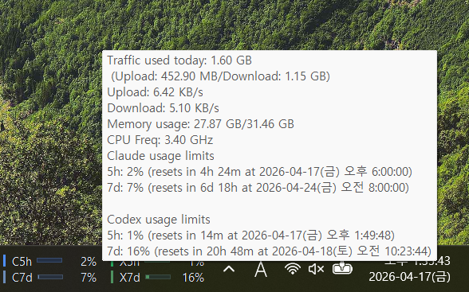

# TrafficMonitor AI Usage Limits


[](https://github.com/sponsors/bemaru)

Languages: English | [한국어](README.ko.md) | [简体中文](README.zh-CN.md)

Taskbar usage limits for Claude and Codex through [TrafficMonitor](https://github.com/zhongyang219/TrafficMonitor) on Windows.
Release packages include `ClaudeUsagePlugin.dll` plus the bundled helper files. Inside TrafficMonitor, the plugin appears as `AI Usage Limits`.

<p align="center">
  
</p>

I built this because Windows did not have a convenient widget for this kind of AI usage-limit status. Claude usage can already be checked from places like Claude Code statusline, Claude Desktop, or Claude's VS Code extension, but those surfaces depend on the current workflow. The Windows taskbar stays visible across editors, terminals, and browsers, so TrafficMonitor's taskbar plugin surface was a good fit.

The plugin puts Claude and Codex usage limits in that fixed taskbar location, instead of requiring separate usage pages to stay open.

## Highlights

- Shows `C5h`, `C7d`, `X5h`, and `X7d` as used percentages directly in the Windows taskbar
- Displays reset timing in the tooltip when the source exposes it
- Uses a bundled Claude web helper for Claude values
- Prefers fresh Codex web-helper values, with local session JSONL and `CODEX_HOME` as a fallback
- Does not keep stale Claude values forever; stale Claude data becomes unavailable

## Quick Start

1. Install TrafficMonitor first:
   - Download an official release from [TrafficMonitor Releases](https://github.com/zhongyang219/TrafficMonitor/releases)
   - Extract it anywhere you want, then run `TrafficMonitor.exe`
   - If you do not need temperature monitoring, the Lite package is usually enough
2. Download the plugin zip that matches the installed TrafficMonitor build from the [latest release](https://github.com/bemaru/trafficmonitor-ai-usage-plugin/releases/latest):
   - `TrafficMonitorAIUsageLimits_v0.3.13_x64.zip` for `x64` TrafficMonitor
   - `TrafficMonitorAIUsageLimits_v0.3.13_x86.zip` for `x86` TrafficMonitor
3. Extract the zip into the TrafficMonitor folder, the folder that contains `TrafficMonitor.exe`.
   After extraction, the layout should look like this:

```text
TrafficMonitor
├─ TrafficMonitor.exe
└─ plugins
   ├─ ClaudeUsagePlugin.dll
   └─ ClaudeUsagePlugin
      ├─ claude-web-helper.ps1
      ├─ codex-web-helper.ps1
      └─ helper
         ├─ claude-web-helper
         │  ├─ index.mjs
         │  ├─ package.json
         │  └─ package-lock.json
         └─ codex-web-helper
            ├─ *.mjs
            ├─ package.json
            └─ package-lock.json
```

4. Restart TrafficMonitor.
5. Open TrafficMonitor's taskbar window and enable `Claude 5h`, `Claude 7d`, `Codex 5h`, and `Codex 7d`.
6. Run the one-time Claude login if you want live Claude values:

```powershell
powershell -ExecutionPolicy Bypass -File .\plugins\ClaudeUsagePlugin\claude-web-helper.ps1 login
```

7. For independent Codex web usage, sign in once in the dedicated Chrome profile:

```powershell
powershell -ExecutionPolicy Bypass -File .\plugins\ClaudeUsagePlugin\codex-web-helper.ps1 login
```

Close the login window and restart TrafficMonitor. The plugin starts the
bundled Codex watcher automatically when it loads and reuses the saved login.
If a watcher is already running when you need to sign in again, run `stop`
before `login`.
Use `start` to launch it manually without restarting, `once` to fetch once,
`status` to inspect state, or `stop` to stop it. A stopped watcher remains
stopped in the current plugin instance and starts again when the plugin is
reloaded. Codex CLI sessions and manually copied tokens are not required.
For the optional JSONL fallback, set `CODEX_HOME` if your Codex state is not
stored in `%USERPROFILE%\.codex`.

The Codex helper is included in builds from this source. Published releases
through v0.3.13 predate it; use your local build for this feature.

If the helper files stay under `plugins\ClaudeUsagePlugin`, the bundled
Claude and Codex watchers auto-start on plugin load. Each plugin instance
attempts startup once; no scheduled task, Windows service, or additional
Windows startup entry is created. Codex startup is skipped until its dedicated
Chrome profile has been initialized by login.

For the full screenshot walkthrough, see [docs/install.md](docs/install.md).

## What It Shows

- `C` = Claude, `X` = Codex
- `5h` = current 5-hour limit window
- `7d` = current 7-day limit window
- `C5h`, `C7d`, `X5h`, and `X7d` show used percentage
- Tooltips show the same used percentage plus reset timing when reset metadata is available
- If Codex local data reports remaining percentage, the plugin converts it before display

<p align="center">
  
</p>

## Data Sources

- Claude reads a fresh helper snapshot from `%LOCALAPPDATA%\trafficmonitor-claude-usage-plugin\claude-web-usage.json`
- Claude helper login stores cookies in a dedicated local browser profile; see [PRIVACY.md](PRIVACY.md)
- Codex prefers `%LOCALAPPDATA%\trafficmonitor-claude-usage-plugin\codex-web-usage.json` when valid and no older than 180 seconds
- The Codex helper uses a dedicated Chrome profile, keeps session tokens inside browser memory, and refreshes every 60 seconds
- If web data is unavailable, Codex falls back to local `%USERPROFILE%\.codex\sessions\**\*.jsonl`; there is no `logs_2.sqlite` fallback
- Failed web fetches remove the previous snapshot; expired windows are unavailable rather than displaying stale values
- JSONL fallback limits are assigned by `window_minutes`: `300` maps to `X5h` and `10080` to `X7d`, even when a seven-day-only payload is delivered as `primary`
- JSONL payloads without `window_minutes` retain the legacy `primary` / `secondary` mapping; refresh reads the newest active session-file window
- If neither fresh web data nor usable JSONL rate-limit payloads are available, Codex shows unavailable
- Codex local payloads can expose either `used_percent` or `remaining_percent`; remaining values are converted to used percentage before display
- `CODEX_HOME` overrides the default Codex path when it resolves to a Windows-readable location
- TrafficMonitor runs on Windows, so Linux-only paths such as `/home/<user>/.codex` are not readable
- Claude helper usage requires Node.js 22+ plus a local Edge or Chrome install
- Codex helper usage requires Node.js 22+ plus Google Chrome; see the live-verification record in [docs/codex-web-helper-investigation.md](docs/codex-web-helper-investigation.md)

For the full runtime model and helper commands, see [docs/runtime.md](docs/runtime.md).

## Compatibility

- Windows only
- TrafficMonitor plugin API v7
- TrafficMonitor itself is not bundled by this repo
- Official release assets are currently provided for `x64` and `x86`
- Internal deployment names stay `ClaudeUsagePlugin.dll` and `ClaudeUsagePlugin\...` for TrafficMonitor compatibility

If you do not need TrafficMonitor's temperature monitoring features, the official Lite release is usually enough.

## Build From Source

Requirements:

- Windows
- Visual Studio 2022 or Build Tools 2022
- Desktop development with C++
- MSVC `v143` toolset
- MFC for the `v143` toolset
- Windows SDK selected by Visual Studio

Build with Visual Studio or run:

```powershell
MSBuild.exe .\ClaudeUsagePlugin.sln /t:ClaudeUsagePlugin /p:Configuration=Release /p:Platform=x64
```

Primary build outputs:

- `build\x64\Release\plugins\ClaudeUsagePlugin.dll`
- `build\Release\plugins\ClaudeUsagePlugin.dll`

For the full output layout and packaging notes, see [docs/build.md](docs/build.md).

## Docs

- [Install guide](docs/install.md)
- [Runtime and helper guide](docs/runtime.md)
- [Build guide](docs/build.md)
- [Troubleshooting](docs/troubleshooting.md)
- [Privacy and local data](PRIVACY.md)
- [License](LICENSE)
- [Notices](NOTICE.md)
- [Changelog](CHANGELOG.md)
- [Release checklist](docs/release-checklist.md)
- [Release notes template](docs/release-notes-template.md)

## Support

If this plugin saves you time, you can support ongoing maintenance here:

- [GitHub Sponsors](https://github.com/sponsors/bemaru)

## Common Issues

- Plugin loads but the usage items do not appear: usually architecture mismatch or the items are not enabled yet. See [docs/install.md](docs/install.md) and [docs/troubleshooting.md](docs/troubleshooting.md).
- Claude shows unavailable: usually the helper snapshot is missing, stale, or the Claude login expired. See [docs/runtime.md](docs/runtime.md) and [docs/troubleshooting.md](docs/troubleshooting.md).
- Codex values do not appear: check `codex-web-helper.ps1 status` and repeat the dedicated login if needed. For JSONL fallback, check `CODEX_HOME` and recent rate-limit data. See [docs/troubleshooting.md](docs/troubleshooting.md).
